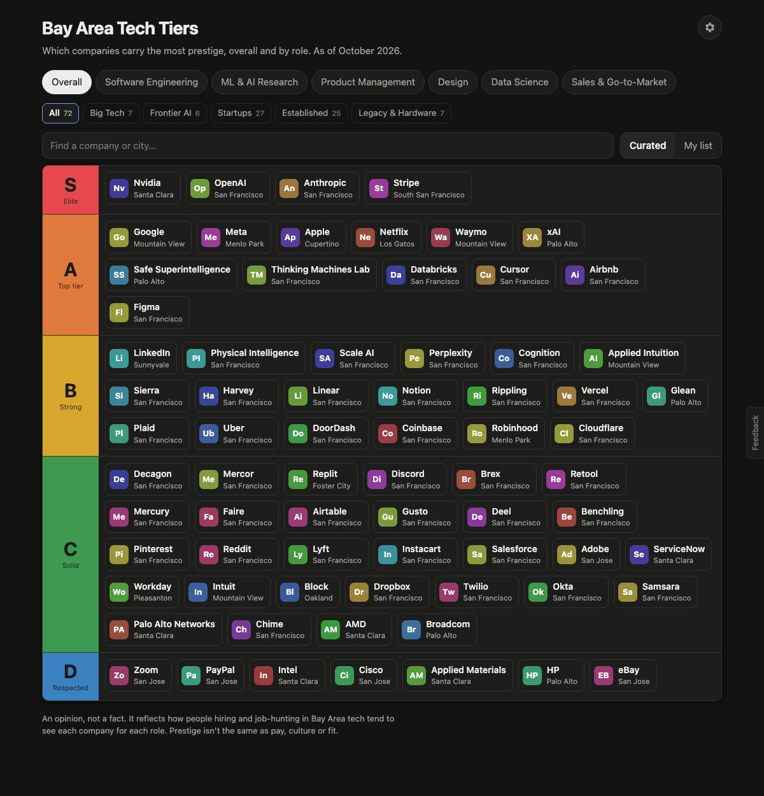
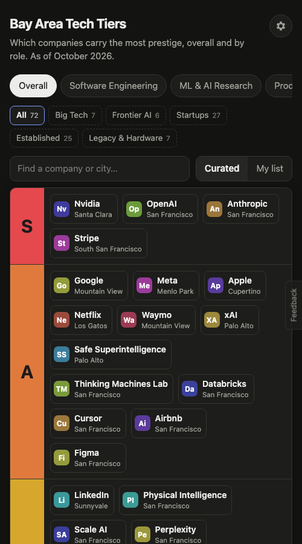
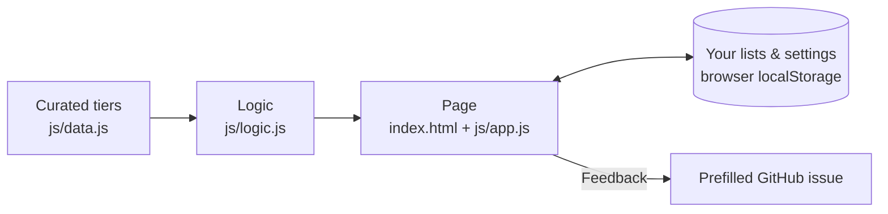

# Bay Area Tech Tiers

Prestige tier lists (S to D) of 72 well-known Bay Area tech companies: an overall list plus one for each of six roles. You can filter by company type (Big Tech, Frontier AI, Startups, Established, Legacy & Hardware) and rearrange any list into your own.

**Live site:** https://amalmehta.github.io/BayAreaTechTiers/

- [How to set up, run and use it](docs/INSTRUCTIONS.md)
- [System design](docs/SYSTEM-DESIGN.md)
- [What's where](docs/FILE-STRUCTURE.md)

*This is an opinion, not a fact. Prestige isn't the same as pay, culture or fit.*
