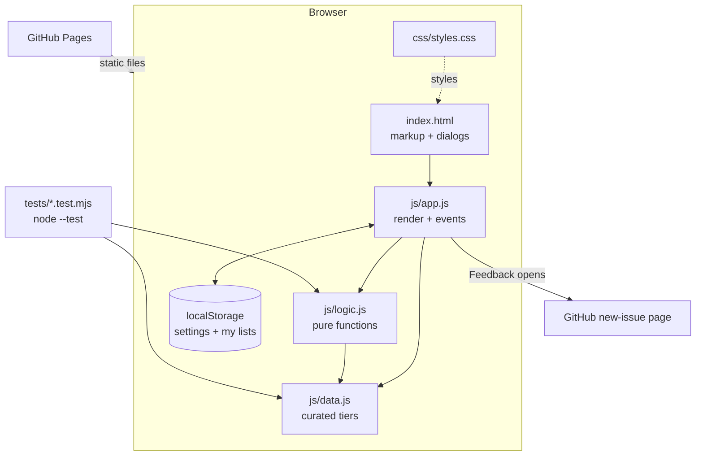

# System Design

Bay Area Tech Tiers is a static website. It has no backend and no build step, and nothing is installed at runtime. GitHub Pages serves the files as they are.

## Architecture

## Components

| Component | Job |
|---|---|
| `js/data.js` | The single source of truth for content: 5 tiers with their meanings, 6 roles, and about 44 companies. Each company has a city, a blurb, a tier for every role and optional notes for specific roles. |
| `js/logic.js` | Pure functions with no DOM or storage access: `buildBoard`, `tierFor`, `moveCompany`, `changedCount`, `matchesQuery`, `sanitizeMyLists`, `sanitizeSettings` and `feedbackUrl`. |
| `js/app.js` | Holds the page state (role, mode, search, my lists), renders the tabs, board and dialogs, and handles clicks, drag and drop, ⌘, and the dialogs. It reads and writes localStorage, wrapped in try/catch. |
| `index.html` / `css/styles.css` | Markup and styling. Colors are CSS tokens on `:root`, with dark values for `prefers-color-scheme` and for `data-theme="dark"`. |

## Main flows

1. **View a role.** `app.js` calls `buildBoard(COMPANIES, role, overrides)` and renders five rows. In Curated mode the overrides are `{}`.
2. **Search.** Typing re-renders the board, and chips where `matchesQuery` is false get a `dim` class. Companies fade out instead of being hidden, so every tier keeps its shape.
3. **Rearrange (My list).** A drop or a tier-button click calls `moveCompany`. It returns new overrides and drops any entry that matches the curated tier, then saves to localStorage and re-renders.
4. **Settings.** The gear button or ⌘, opens the settings dialog. Each change is applied immediately (theme attribute, `hide-cities` class) and saved.
5. **Feedback.** The form builds a `github.com/<repo>/issues/new?title=…&body=…` URL and opens it in a new tab. The visitor submits the issue (or doesn't) on GitHub.

## Where data lives

- **Curated tiers:** in `js/data.js`, versioned in git.
- **Each visitor's lists and settings:** in their own browser's localStorage, under `bayAreaTechTiers.myLists` and `bayAreaTechTiers.settings`. They're never sent anywhere. When loaded, the data passes through the sanitize functions, so stale company IDs, bad tiers or hand-edited junk are dropped.
- **Feedback:** GitHub Issues on the repo, and only if the visitor submits.

## Key decisions and trade-offs

- **Website only, no Mac app.** The brief's deliverable is a website, and the content is read-mostly. The user confirmed this.
- **No framework or build step.** It's plain ES modules. *Pro:* nothing to install or update, and it deploys straight to Pages. *Con:* rendering re-creates the board on each change. That's fine for about 44 chips.
- **Overrides are stored as diffs from the curated list.** *Pro:* when the curated tiers change, untouched companies follow the new curation. *Con:* order inside a tier isn't customizable. Chips keep the data file's order.
- **One tier string per company** (`"SSSAAS"`) instead of per-role lists. *Pro:* a company can't be missing from a role or appear twice. *Con:* the data file is less readable at a glance. Notes and tests offset that.
- **Feedback goes through a prefilled GitHub issue** instead of a form backend. *Pro:* no server, no stored personal data, and spam is handled by GitHub. *Con:* visitors need a GitHub account.
- **Monogram tiles instead of company logos.** This avoids using trademarks and needs no image assets.
- **Prestige is an opinion.** The page says so in the footer, and the date is shown (`AS_OF`).

## Testing

- `npm test` runs Node's built-in runner, with no dependencies.
  - `tests/data.test.mjs` checks: unique IDs and names, a valid tier for every company in every role, notes that only use real roles, a city and blurb for every company, and 3 to 6 companies in S and at least one in D for each role.
  - `tests/logic.test.mjs` covers: board completeness, overrides, `moveCompany` (including moving back to the curated tier and ignoring bad tiers), search (case, accents, blank queries), sanitizing junk storage and settings, and the feedback URL.
- Checked by hand in a browser: role tabs, search, My list by drag and by buttons, the stored state, the ⌘, shortcut, theme switching, hiding cities, dark mode, and the phone width (375px, no horizontal scroll).

## Known limits

- The rankings are one curated opinion as of October 2026. They aren't crowd-sourced and aren't backed by data.
- The list covers about 44 well-known companies with Bay Area headquarters or major Bay Area presence. Many respected companies (and all non–Bay Area ones) aren't included.
- HTML5 drag and drop doesn't work on touch screens. Phones use the tier buttons in the detail panel instead.
- In some browsers ⌘, opens the browser's own preferences, and the page can't override that. The gear button always works.
- My lists live in a single browser. They don't sync across devices and can't be shared.
